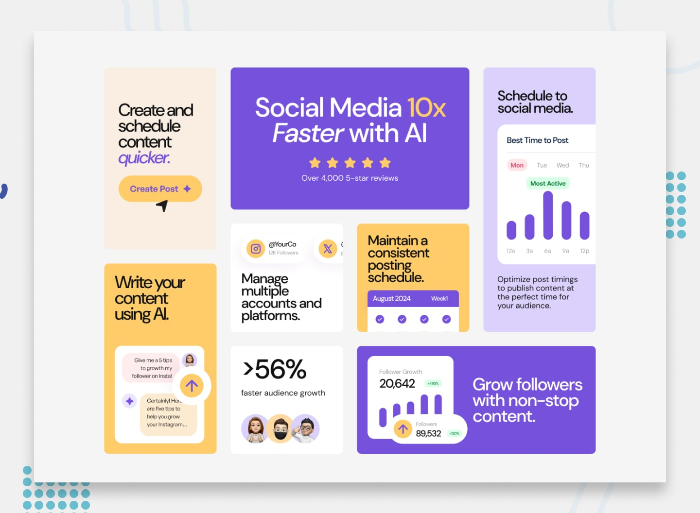

# Bento Grid

A responsive Frontend Mentor challenge solution built with semantic HTML and CSS Grid. The goal was to recreate a modern bento-style social media dashboard layout that adapts cleanly from mobile to desktop.

## Screenshot



## Overview

This project focuses on:

- Creating a polished card-based layout using CSS Grid
- Matching the provided design as closely as possible
- Ensuring the layout remains responsive across screen sizes
- Practicing spacing, typography, and image placement in a realistic UI challenge

### Users should be able to

- View the interface in an optimized layout for their device
- Understand the content flow across different screen widths
- See a visually balanced dashboard inspired by social media planning tools

## Live preview

Open `index.html` directly in the browser, or run a simple local server:

```bash
python3 -m http.server 8000
```

Then visit `http://localhost:8000`.

## Built with

- HTML5
- CSS3
- CSS Grid
- Responsive design
- Asset-based layout styling

## Project notes

This challenge is a good example of using CSS Grid for complex, asymmetrical layouts while still keeping the code readable and maintainable. The two-item left column on desktop and the mobile stacking behavior were the main layout detail to pay attention to.

## Author

- Website: [Ruben de Man](https://rubendeman.nl)
- Frontend Mentor: [@rubendev](https://www.frontendmentor.io/profile/rubendev)

## Acknowledgment

Challenge by [Frontend Mentor](https://www.frontendmentor.io/).
